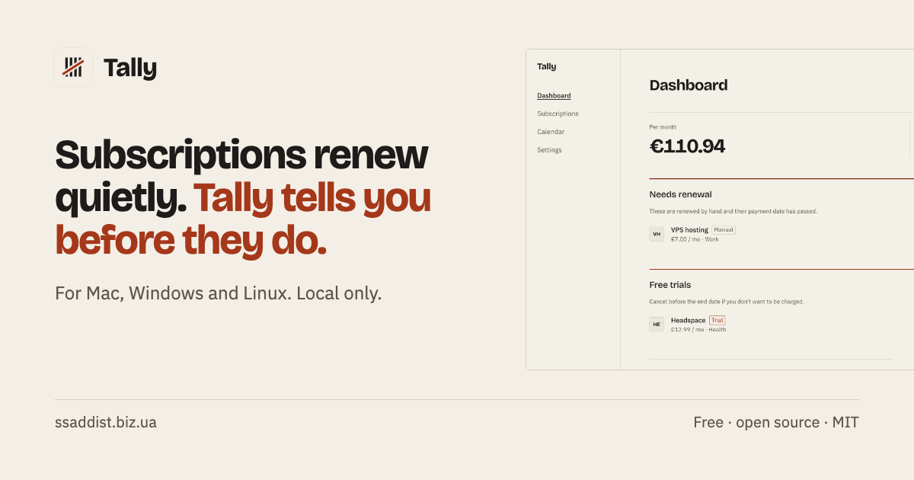

# Tally — landing page

Source of **[ssaddist.biz.ua](https://ssaddist.biz.ua)**, the website for [Tally](https://github.com/ssaddist/tally), a local-only desktop app that tracks your subscriptions and reminds you before each charge.



## Stack

- React 18 + Vite
- Ukrainian, Russian and English
- Self-hosted fonts, no analytics
- Deployed on Cloudflare Workers (static assets)

## Run locally

```bash
cd sub-landing
npm install
npm run dev
```

Build: `npm run build` from the repo root (output goes to `react-app/dist`).

## License

[MIT](LICENSE)
